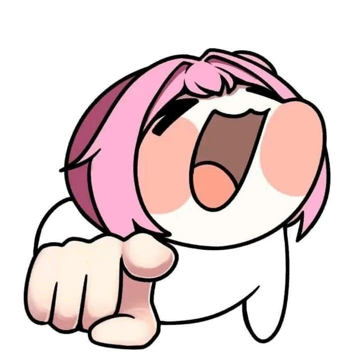

<p align="center">
  
</p>

# NEKOSIA ARCHIVE DECK // FIELD JOURNAL № 01

```text
+------------------------------------------------------------------------------+
| DOCUMENT ID   : NAD-FJ-2026-01                                               |
| AUTHOR        : Nimzz                                                        |
| MOTIVATION    : Entah lah jir gabut doang        |
| VISUAL SYSTEM : Cozy Field Journal + Brutalist-Editorial Datasheet           |
| UPSTREAM API  : https://api.nekosia.cat/api/v1                               |
+------------------------------------------------------------------------------+
```

> **Catatan Penulis (Nimzz):**
> Project ini beneran cuma **project iseng yang dibuat karena lagi gabut aja wkwkwk**. Nggak ada tujuan komersial atau misi berat—cuma pengen punya tempat santai buat *gacha* gambar anime/kemonomimi dari Nekosia API, ngintip palet warna HEX-nya, terus bisa langsung diunduh tanpa kena blokir CORS browser.

---

## § 01. Ikhtisar Jurnal & Arah Seni (Laid-Back Field Journal UI)

**Nekosia Archive Deck** memadukan estetika buku catatan sketsa yang hangat (*Cozy Field Journal*) dengan ketegasan indeks teknis bergaya *Brutalist-Editorial*:

- **Palet Kertas & Tinta Hangat**: Menggunakan dasar kertas sketsa krem (`#f7f3e8`), garis tepi hijau pinus (`#2e4f3e`), serta aksen jingga hangat (`#e26334`) di atas latar titik-titik buku jurnal (*dotted grid*).
- **Bingkai Polaroid & Aksen Washi Tape**: Setiap ilustrasi dibingkai layaknya lembaran foto instan yang ditempel menggunakan selotip kertas (*washi tape*) dan dilengkapi animasi **Instant-Film Polaroid Eject** saat gambar acak ditarik.
- **Tipografi 3 Peran**:
  1. `--font-display` (*Playfair Display*): Judul utama bergaya majalah & buku sketsa cetak.
  2. `--font-sans` (*Plus Jakarta Sans*): Navigasi dan teks penjelasan yang bersih.
  3. `--font-mono` (*JetBrains Mono* + `tabular-nums`): Indeks tabel, ukuran byte, dimensi piksel, kode HEX, dan terminal API.

---

## § 02. Mekanisme Gacha Draw & Efek Animasi Polaroid

Agar pencarian gambar acak terasa menyenangkan dan tidak terikat pada filter kategori yang sedang aktif di halaman utama, aplikasi ini menyediakan **Floating Gacha Draw Widget** (di pojok kanan bawah layar) serta panel **Gacha Spotlight**:

1. **Filter-Independent Random Pull**:
   Saat tombol **`Gacha Draw`** ditekan, fungsi `fetchSingleRandomImage()` secara mandiri mengundi kategori dari kolam koleksi Nekosia (`random`, `catgirl`, `foxgirl`, `wolfgirl`, `cute`, `blue-archive`, `vtuber`, `maid`, `headphones`, `heterochromia`, dll.) tanpa mengubah atau merusak filter kategori yang sedang diatur pengguna di bagian *Filter Matrix*.
2. **Non-Obstructive Tactile Animation**:
   - **Ticket Shake & Chromatic Spark Burst**: Tombol tiket berguncang halus (`animate-gacha-shake`) sambil memercikkan partikel warna (`animate-spark-burst`) yang diambil langsung dari palet gambar.
   - **Instant-Film Polaroid Ejection**: Kartu hasil *draw* meluncur keluar (`animate-polaroid-eject`) dengan transisi pengembangan warna film instan (dari rona sepia hangat menuju warna asli) disertai cap kategori (`animate-stamp-pop`).

---

## § 03. Arsitektur Teknis & Cara Kerja Proxy Download Service

Salah satu kendala paling sering dialami saat membuat web galeri dari CDN eksternal adalah kebijakan **CORS (Cross-Origin Resource Sharing)**: ketika browser mencoba mengambil gambar dari domain lain menggunakan `fetch()` untuk dijadikan `Blob` unduhan, browser sering menolak atau malah membuka gambar di tab baru alih-alih menyimpannya ke perangkat.

### Alur Kerja `/api/download` (Server-Side Binary Stream)

```text
[ Browser: Klik Tombol "Unduh" ]
       │
       ▼
[ Express Server (server.ts) -> GET /api/download?url=...&filename=... ]
       │  1. Validasi hostname terhadap whitelist (cdn.nekosia.cat, i.pximg.net)
       │  2. Injeksi header User-Agent & Referer (khususnya untuk sumber Pixiv)
       │  3. Fetch arrayBuffer biner langsung dari upstream CDN
       ▼
[ Stream Response ke Browser ]
       ├─ Content-Type: image/jpeg (atau sesuai upstream)
       ├─ Content-Disposition: attachment; filename="nekosia-catgirl-66aac32b-original.jpg"
       └─ Access-Control-Allow-Origin: *
```

Jika aplikasi dijalankan di lingkungan terisolasi yang memblokir koneksi keluar, layanan pengunduh di `src/services/nekosiaService.ts` memiliki **3 Lapis Strategi Fallback**:
1. **Strategi 1 (`server-stream`)**: Mengunduh biner asli melalui rute proxy Express `/api/download`.
2. **Strategi 2 (`cdn-blob`)**: Mengambil `Blob` langsung dari CDN melalui `fetch(url, { mode: 'cors' })`.
3. **Strategi 3 (`canvas-plate`)**: Merender ulang lembaran *Archival Datasheet Plate* resolusi tinggi (`1200×1500 px`) menggunakan HTML5 `<canvas>` lengkap dengan palet 14 warna dan blok spesifikasi teknis, lalu mengekspornya sebagai file `.png`.

---

## § 04. Signifikansi Ekstraksi Palet 14 Warna & Profil Warna ICC

Setiap respons dari Nekosia API v1 menyertakan objek `colors` dan `metadata`:

```json
"colors": {
  "main": "#F1DCC4",
  "palette": [
    "#BBA7BE", "#F4FCFC", "#90655F", "#EEDCCF", "#B8948D",
    "#FBF3CE", "#FAA89E", "#D9A897", "#EECCCE", "#F6FBF0",
    "#95CACD", "#FAC5A4", "#87ABB2", "#A2F7F7"
  ]
}
```

### Mengapa Ekstraksi 14 Warna Ini Penting?
1. **Referensi Harmoni Warna bagi Ilustrator & Desainer UI**:
   Ilustrasi anime berkualitas tinggi memiliki distribusi nilai terang-gelap (*value*), warna kulit, bayangan rambut, dan aksen mata yang sangat terukur. Dengan mengekstrak **1 warna dominan (`main`)** + **14 sampel warna palet (`palette`)**, pengguna dapat menyalin kode HEX secara instan atau mengekspornya menjadi lembaran vektor **`.svg` Color Swatch Sheet** untuk dijadikan referensi desain.
2. **Adaptive Surface Framing (Zero Broken Frame)**:
   Komponen `<ImagePlate />` menggunakan warna `colors.main` sebagai warna dasar bingkai bahkan sebelum gambar selesai dimuat dari jaringan, sehingga tidak pernah ada kilatan kotak putih kosong yang mengganggu mata.
3. **Inspeksi Profil Warna ICC (`Display P3` vs `sRGB`)**:
   Properti `metadata.original.colorProfile` memberi tahu apakah ilustrator mengekspor karyanya menggunakan ruang warna lebar (**Display P3**) atau ruang warna standar (**sRGB** / `null`), ditambah perbandingan ukuran byte antara file **Original Master** dan **CDN Compressed**.

---

## § 05. Daftar Endpoint Nekosia API v1 & Kuota Rate Limit

| Endpoint | Metode | Parameter Utama | Fungsi di Aplikasi |
| :--- | :--- | :--- | :--- |
| `/api/v1/images/:category` | `GET` | `count`, `additionalTags`, `blacklistedTags`, `rating`, `session`, `id` | Mengambil batch galeri berdasarkan kategori & filter tag, serta digunakan oleh mesin Gacha Draw. |
| `/api/v1/images/nothing` | `GET` | `additionalTags` (wajib $\ge 1$), `blacklistedTags`, `count` | Mode *Unrestricted Tag* yang melewati filter kategori bawaan dan mencari murni dari tag. |
| `/api/v1/getImageById/:id` | `GET` | `:id` (24-char hex string) | Pencarian langsung satu ilustrasi spesifik untuk dibuka di *Datasheet Inspector*. |
| `/api/v1/image-of-the-day` | `GET` | — | Mengambil ilustrasi unggulan harian yang diperbarui setiap pukul 00:00 UTC. |

### Kuota Rate Limit Upstream
- **`nekosia.cat`**: Maksimum **96 request** dalam **140 detik**.
- **`api.nekosia.cat`**: Maksimum **300 request** dalam **5 menit**.
- **`cdn.nekosia.cat`**: Maksimum **600 request** dalam **5 menit**.

---

## § 06. Cara Menjalankan di Lokal

```bash
# 1. Instal dependensi
npm install

# 2. Jalankan server Express + Vite di port 3000
npm run dev

# 3. Pemeriksaan tipe TypeScript & Build produksi
npm run lint
npm run build
```

Sebelum build produksi, salin `.env.example` menjadi `.env`, lalu isi `VITE_SITE_URL` dengan domain asli tanpa garis miring di akhir. Nilai ini dipakai untuk canonical, Open Graph, `robots.txt`, `sitemap.xml`, dan `manifest.webmanifest`. Seluruh pengaturan metadata ada di `site.config.ts`.

---

## § 07. Kredit

- **Dibuat oleh**: **Nimzz**
- **API & CDN**: [Nekosia API v1](https://nekosia.cat) — Seluruh hak cipta karya seni dimiliki oleh masing-masing ilustrator asli sebagaimana tertera pada metadata `attribution` dan tautan `source` di setiap kartu.
